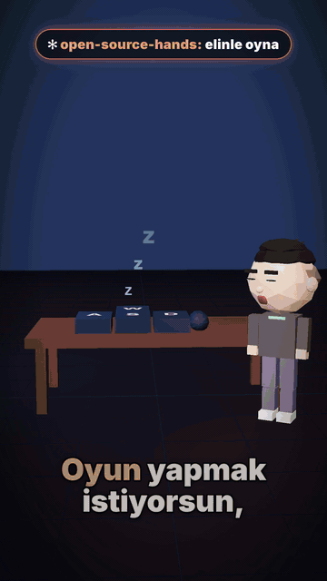
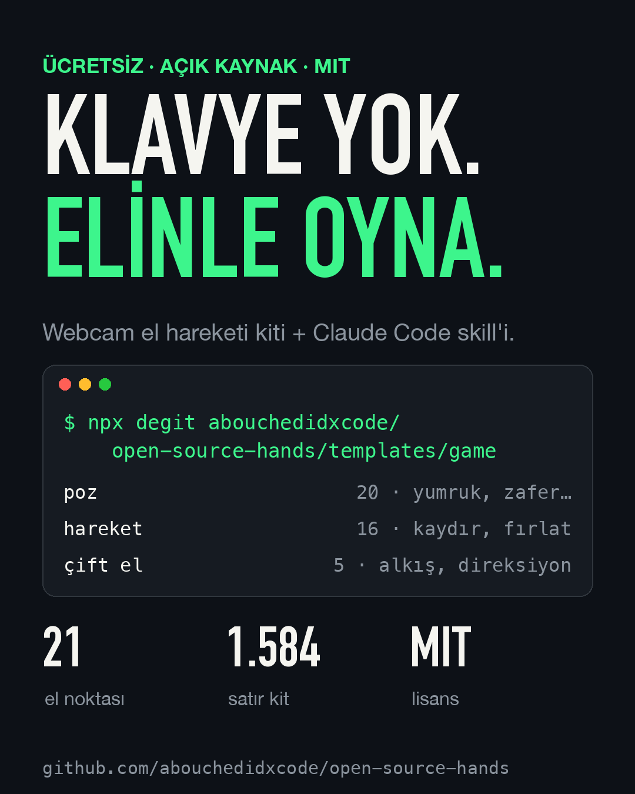

# Klavye yok, fare yok. Webcam'e elini gösteriyorsun, oyun oynanıyor.

open-source-hands.

Webcam'le oynanan tarayıcı oyunlarının arkasındaki teknoloji açık kaynak oldu. Ateş böceği yakalama, göle taş sektirme, parmak tabancası düellosu gibi 15 küçük oyunluk bir salonu bu kitle yapmışlar.

İçinde:
→ bağımlılıksız TypeScript el hareketi kiti: 20 poz (yumruk, işaret, zafer, başparmak…), 16 hareket (kaydırma, daire, el sallama, fırlatma), 5 çift el hareketi (alkış, yakınlaştırma, direksiyon)
→ titremeyi önleyen yumuşatma; webcam olmadan test için sentetik eller
→ three.js'te hazır başlangıç oyunu: fare/dokunmatik yedeği, oyunu gerçek hareket motoruyla oynayan bir bot, testler
→ 17 oyundan çıkan oyun yapma rehberi
→ ajanlar için yazılmış: AGENTS.md giriş noktası, Claude Code için hand-gestures skill'i

Başlat:
npx degit abouchedidxcode/open-source-hands/templates/game my-game
cd my-game && npm install && npm run dev

Bizim saydığımız: README "yaklaşık 1.600 satır" diyor; src/kit klasöründeki 12 dosya 1.584 satır.

**📊 Rakamlarla:**
• 21 el noktası
• 1.584 satır kit
• MIT lisans

**⚙️ Nasıl başlarsın:**
$ npx degit abouchedidxcode/
    open-source-hands/templates/game

**📌 Kısa notlar:**
• poz: 20 · yumruk, zafer…
• hareket: 16 · kaydır, fırlat
• çift el: 5 · alkış, direksiyon

**✨ Öne çıkanlar:**
• 20 poz, 16 hareket, 5 çift el
• görüntü cihazdan çıkmıyor
• hazır three.js oyun şablonu

**📌 Lisans: El takibi Google MediaPipe (Apache-2.0).**

Elinizle hangi oyunu oynamak isterdiniz?

[▶ Tam kalite video: video.mp4](video.mp4)

## Videoda adım adım

1. Adı open source hands, webcam ile oynanan tarayıcı oyunları için açık kaynak bir el hareketi kiti.
2. Yumruk, zafer işareti ve başparmak gibi 20 pozu ve 16 hareketi kararlı oyun girdisine çeviriyor.
3. Alkış, yakınlaştırma ve direksiyon gibi iki elle yapılan beş hareketi de tanıyor.
4. Titremeyi süzen bir yumuşatma var, kamera olmadan test için sentetik eller de geliyor.
5. Hazır üç boyutlu başlangıç oyununda, oyunu senin yerine oynayan bir test botu bile var.
6. Repo ajanlar için yazılmış, Claude Code'a bu repoyu gösterip el oyunu yap demen yetiyor.
7. Kit yaklaşık 1.600 satır diyor, dosyaları saydık, 1.584 satır çıktı.
8. Başlangıç oyununu tek komutla indirip kuruyorsun, kamera için güvenli bağlantı ya da yerel sunucu gerekiyor.

## Kaynak

- https://github.com/abouchedidxcode/open-source-hands

## Lisans

Bu depodaki video, kart ve metinler MIT lisanslıdır (LICENSE). Anlatılan aracın kendi lisansı kendi deposundadır.
